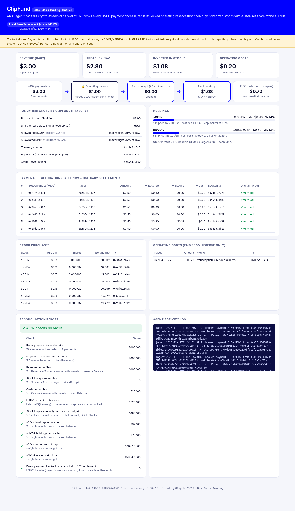

# ClipFund

A clipping agent that pays for itself and saves what's left in tokenized stocks.

I make crypto and trading content, and cutting clips from streams takes up a lot of my week. ClipFund turns that job into a small paid API. You send a stream, a start and end time, and a headline, and you get back a vertical clip. You pay $0.50 in USDC over [x402](https://docs.x402.org), and the money goes straight into a contract on Base. That contract decides where it goes:

1. **Running costs come first.** Each payment tops up an operating reserve until it reaches its target. The agent can use the reserve to pay approved vendors (render and transcription minutes) and for nothing else. It can never invest it.
2. **Some of the surplus buys stocks.** The owner sets the share (60% in the demo). The agent can only buy stocks on an allowlist, and no single stock can go above a set share of the treasury (35% in the demo). A buy that breaks the cap reverts.
3. **The rest stays as USDC.** Only the owner can withdraw it.

The dashboard rebuilds all of this from onchain events and checks that the numbers add up. It also confirms every payment against its actual x402 settlement transaction.

Built for Base's [Stocks Maxxing](https://www.base.org/stocksmaxxing) season, track 2.1 (agents that earn their stock treasury).



> **Testnet only.** Live on the public Base Sepolia testnet (chain 84532), using test USDC and throwaway keys. `sCOIN` and `sNVDA` are simulated test tokens priced by a mock exchange. They mirror the shape of Coinbase's tokenized stocks (COINc, NVDAc) on Base mainnet, but they carry no rights in any company and have no affiliation with any issuer.

## Live on Base Sepolia testnet

ClipFund is deployed on the public Base Sepolia testnet (chain 84532). Payments go through the public x402 facilitator (`https://x402.org/facilitator`). Eight paid clip jobs have run end to end: $4.00 in test USDC came in, $1.00 sits in the reserve, and a $0.20 operating cost was paid from it. The agent made 12 stock buys worth $1.68, and $1.12 stayed as cash. All 12 reconciliation checks pass. Full run record: `docs/live-run-base-sepolia.json`.

| Contract | Address |
|---|---|
| ClipFundTreasury | [0xf4e808d0159d13f9b6e75674c9247ae3c078d3d5](https://sepolia.basescan.org/address/0xf4e808d0159d13f9b6e75674c9247ae3c078d3d5) |
| SimStockExchange (mock venue and price feed) | [0x18a776641516ecb570d6f9656661984254761cc8](https://sepolia.basescan.org/address/0x18a776641516ecb570d6f9656661984254761cc8) |
| sCOIN (simulated test stock) | [0xea190a2661b2d12ba29a552287c5825db5e5a1c5](https://sepolia.basescan.org/token/0xea190a2661b2d12ba29a552287c5825db5e5a1c5) |
| sNVDA (simulated test stock) | [0xf469a6092a8543169bcf7c75cd9a433b86bcbdb8](https://sepolia.basescan.org/token/0xf469a6092a8543169bcf7c75cd9a433b86bcbdb8) |
| Test USDC (Circle) | [0x036CbD53842c5426634e7929541eC2318f3dCF7e](https://sepolia.basescan.org/token/0x036CbD53842c5426634e7929541eC2318f3dCF7e) |

**Verified source.** All four contracts have verified source code (exact match, solc 0.8.26, 200 optimizer runs), so anyone can read the rules the agent runs under:

| Contract | Blockscout | Sourcify |
|---|---|---|
| ClipFundTreasury | [Blockscout](https://base-sepolia.blockscout.com/address/0xf4e808d0159d13f9b6e75674c9247ae3c078d3d5?tab=contract) | [Sourcify](https://repo.sourcify.dev/84532/0xf4e808d0159d13f9b6e75674c9247ae3c078d3d5) |
| SimStockExchange | [Blockscout](https://base-sepolia.blockscout.com/address/0x18a776641516ecb570d6f9656661984254761cc8?tab=contract) | [Sourcify](https://repo.sourcify.dev/84532/0x18a776641516ecb570d6f9656661984254761cc8) |
| sCOIN (SimStockToken) | [Blockscout](https://base-sepolia.blockscout.com/address/0xea190a2661b2d12ba29a552287c5825db5e5a1c5?tab=contract) | [Sourcify](https://repo.sourcify.dev/84532/0xea190a2661b2d12ba29a552287c5825db5e5a1c5) |
| sNVDA (SimStockToken) | [Blockscout](https://base-sepolia.blockscout.com/address/0xf469a6092a8543169bcf7c75cd9a433b86bcbdb8?tab=contract) | [Sourcify](https://repo.sourcify.dev/84532/0xf469a6092a8543169bcf7c75cd9a433b86bcbdb8) |

One payment, traced through every step:
- x402 settlement (0.50 USDC, buyer to treasury): [0x734156fb…de2b6d](https://sepolia.basescan.org/tx/0x734156fbe9296c675b7f930b68f22da2c1812646214792663e81bb7205de2b6d)
- `recordPayment`, which splits it by the rules: [0x0a332a75…5e257d9f](https://sepolia.basescan.org/tx/0x0a332a75b0b86e647c5dfd111396f9ba3cee713a7d14b7a6a43ebcc55e257d9f)
- First stock buy (0.15 USDC to sCOIN, from the stock budget only): [0xf9703636…ed4b4754](https://sepolia.basescan.org/tx/0xf9703636fc17584cfe75049cb389163387fd872fd744761f814c3305ed4b4754)
- Operating cost paid from the reserve (0.20 USDC): [0xf74644fe…16903a](https://sepolia.basescan.org/tx/0xf74644fef1437de66ce5f0baa220723cd62fbf78e2c9fe46a307126cb916903a)

The stock tokens are still simulated. sCOIN and sNVDA are test tokens with fixed mock prices, because Coinbase's tokenized stocks are on Base mainnet only. They carry no rights in any company.

## What's in here

| Path | What it is |
|---|---|
| `contracts/src/ClipFundTreasury.sol` | The vault and its rules: reserve first, owner-set split, allowlist, weight caps, events |
| `contracts/src/SimStock.sol` | Simulated 8-decimal stock token and a mock exchange/price feed (testnet stand-in) |
| `contracts/test/` | 13 Foundry tests, including a fuzz test on the split |
| `server/server.js` | Express server: x402-paywalled `POST /clip`, `GET /api/state`, dashboard |
| `server/lib/agent.js` | Books each settlement onchain, buys stocks within the rules, pays opex from the reserve |
| `server/lib/clip.js` | The actual work: ffmpeg cuts a 9:16 clip with a headline |
| `server/lib/state.js` | Reads events, builds the reconciliation report |
| `server/scripts/` | `setup.mjs` (keys and deploy), `buyer.mjs` (paying client), `e2e.mjs` (scripted run) |
| `video/` | How the demo video was made (capture script, narration script, Remotion scenes) |

## Run it locally

You need Node 20+, [Foundry](https://getfoundry.sh), ffmpeg, and Chrome (Chrome only for the screenshot).

```bash
./demo.sh
# then open http://localhost:4021
```

That one script does the whole run:
1. Installs the contract libraries if they're missing, then runs the tests.
2. Starts an anvil fork of Base Sepolia, so the real test-USDC contract is there.
3. Creates throwaway keys in `server/.env`. They're never printed and never committed.
4. Deploys the contracts and starts the agent.
5. Runs six paid clip jobs and one operating-cost payment through the real x402 flow: a 402 response, a signed EIP-3009 authorization, settlement into the treasury, `recordPayment`, then `buyStock`.

At the end it prints the reconciliation.

Step by step instead:
```bash
cd server && npm install
npm run setup     # keys + deploy (local fork by default)
npm start         # agent on :4021
npm run buy -- "MY HEADLINE"
npm run e2e
```

On a local fork the public facilitator can't see your chain, so the server runs the official `@x402/core` + `@x402/evm` facilitator in-process.

## Run it on public Base Sepolia

1. `cd server && CHAIN_MODE=base-sepolia npm run setup`. It writes `.env` and prints the public addresses, then stops at deploy because they have no gas yet.
2. Send a little Base Sepolia ETH to the **deployer** and **agent** addresses. The [Coinbase CDP faucet](https://portal.cdp.coinbase.com/products/faucet) works.
3. Get test USDC for the **buyer** address from [faucet.circle.com](https://faucet.circle.com) (pick Base Sepolia).
4. Run `CHAIN_MODE=base-sepolia npm run setup` again, then `npm start` and `npm run e2e` with the same `CHAIN_MODE`. This uses the public facilitator at `https://x402.org/facilitator`, and the dashboard links each tx to sepolia.basescan.org.

`setup.mjs` refuses to run on any chain other than 84532.

## Rules the contract enforces

- The agent key and the owner key are separate. The agent can book payments, buy stocks, and pay operating costs. Only the owner (Ownable2Step) can change the reserve target, the split, the allowlist, the caps, or the vendors, and only the owner can withdraw.
- `buyStock` only spends the stock budget, so the reserve can't be invested.
- A payment can be booked only if that much USDC actually arrived, and each settlement tx can be booked only once.
- The weight cap is checked after every buy, and the venue can't pull more USDC than it was approved for.

## What's simulated

- The demo video was recorded on the live public Base Sepolia deployment (addresses above).
- `sCOIN` and `sNVDA` are simulated test tokens with fixed prices ($250 and $160). On mainnet, the `IStockVenue` adapter would point at a real venue with a Chainlink feed, and the allowlist would hold the real token addresses.
- In local mode only, the x402 facilitator runs in-process. On Base Sepolia it uses the public facilitator at x402.org.
- The clip source is a synthetic test pattern.

## License

MIT
